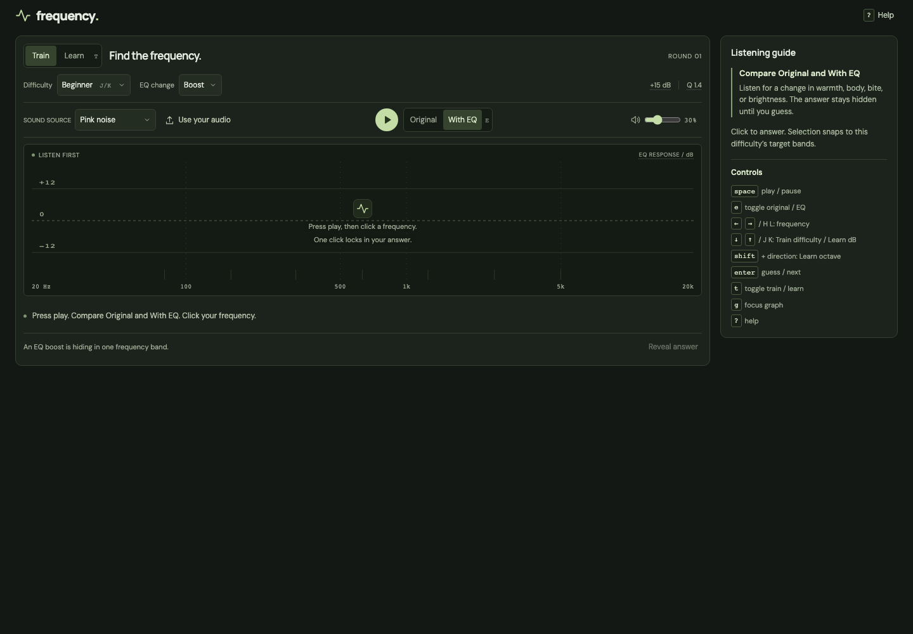
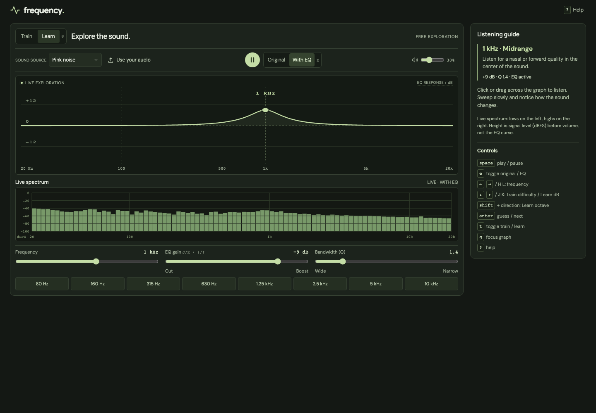

# Frequency — EQ ear trainer

[Try it now](https://a-chen.github.io/eq-trainer/)

My take on an EQ trainer, built for my own untrained ears. Entirely AI-coded—I just needed a tool that worked. Feel free to use the code, change it, and share your own version. Tools like this should be free.

Practice hearing EQ boosts and cuts. Runs in your browser. No accounts, backend, or API keys. Audio files stay on your device.





## Use

Start with low volume and headphones. Use a modern browser with Web Audio support.

**Train:** press play, compare **Original** and **With EQ**, then click the frequency you hear on the graph. Each click scores your answer and reveals the EQ curve. Choose **Next round** to try again.

- Sources: pink noise, a synthesized drum/bass groove, or a local audio file up to 50 MB. Codec support depends on your browser.
- EQ: boost, cut, or mixed. Mixed hides the boost/cut direction until you answer.
- Difficulty: Beginner (7 bands, 15 dB, Q 1.4), Intermediate (10 bands, 9 dB, Q 2), Advanced (15 bands, 6 dB, Q 3).
- Scoring: guesses snap to the target bands. An exact match earns 100 points; nearby bands earn partial credit. Revealing without guessing earns zero.
- History: **Help → Practice history**. Totals are saved in local storage and synced across tabs; recent-round details last only for the session. Audio files are never stored or uploaded.

Changing difficulty or EQ mode starts a new round without clearing history. Playback pauses when you leave the page; press play to resume. Changing sources restarts the loop.

**Learn:** sweep the graph from **20 Hz to 20 kHz**, adjust gain (**−15 to +15 dB**) and bandwidth (**Q 0.4–6**), and compare with the original. Clicking the graph or a preset starts audio. Your training round and stats stay unchanged.

The live spectrum measures post-EQ audio before the volume control, in dBFS. It shows peak FFT magnitude per log-spaced band, not equal-energy-per-octave levels: flat pink noise slopes downward. The EQ curve is separate and can be previewed while paused.

Hover, focus, or tap an underlined dB or Q value for help. dB controls EQ strength, not listening volume. Lower Q is wider; higher Q is narrower. Volume is not calibrated to your device's sound pressure.

## Keys

- **Space:** play/pause. **E:** toggle Original / With EQ. **A / B:** select either directly.
- **T:** toggle Train / Learn. **G:** focus the graph.
- **← / →** or **H / L:** choose a Train band or sweep Learn by a semitone. Hold Shift in Learn for octave steps.
- **↓ / ↑** or **J / K:** harder/easier difficulty in Train; lower/raise gain by 1 dB in Learn.
- **Home / End:** jump to frequency limits. **Enter:** guess or advance in Train.
- **?:** toggle Help. **Escape:** dismiss Help or an explanation.

Shortcuts leave normal form controls alone. Hold direction keys to repeat.

## Develop

Requires Node.js **22.19+** and npm.

```sh
npm ci
npm run dev
```

Open http://127.0.0.1:5173.

```sh
npm test                        # Unit tests
npx playwright install chromium # One-time browser setup
npm run test:e2e                 # Desktop and mobile-sized Chromium tests
npm run build                   # Type-check and build dist/
npm run preview                 # Serve the build
```

Browser tests cover behavior and audio scheduling, not listening quality or actual Safari/iOS.

## Deploy

GitHub Pages needs no backend. In [repository settings](https://github.com/a-chen/eq-trainer/settings/pages), set **Pages → Source → GitHub Actions**.

Push to `main` to run unit tests, build, and deploy. Pull requests run tests and build only. If Pages was enabled after the first workflow run, rerun **Deploy to GitHub Pages** from Actions.

Site URL after deployment: https://a-chen.github.io/eq-trainer/

For another static host, run `npm ci && npm run build` and publish `dist/`. Relative asset paths support repository subpaths and domain roots. No routing fallback needed. Serve over HTTP(S), not directly from disk. Visitors don't need Node.js.

## Source

TypeScript and Vite. No UI framework or runtime dependencies.

- `src/audio.ts`: synthesis, decoding, playback, EQ.
- `src/game.ts`: rounds, scoring, saved stats.
- `src/main.ts`: UI, controls, playback lifecycle, cross-tab sync.
- `src/learn.ts`: logarithmic frequency mapping.
- `src/visualizer.ts`: FFT display.
- `src/parameter-help.ts`: dB/Q explanations.
- `src/style.css`: layout and fonts.
- `tests/`: unit and browser tests.

Bundled DM Sans and Manrope fonts use the SIL Open Font License; see `public/fonts/`.
